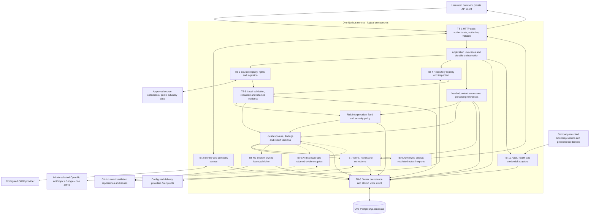
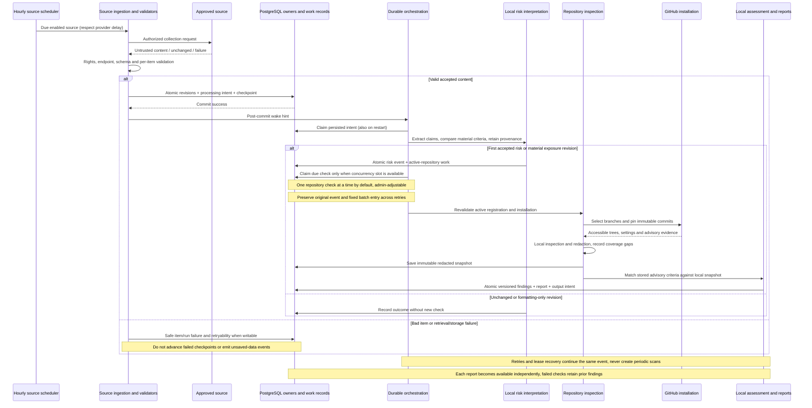
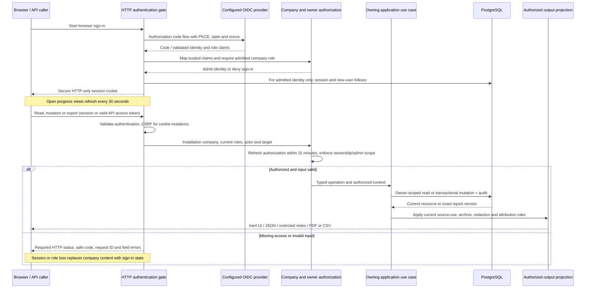
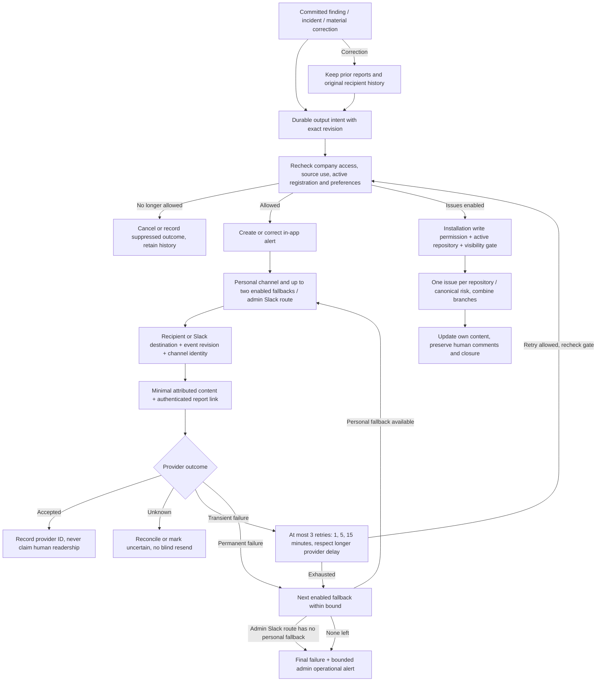

# Architecture

This document owns how The Daily Dread is built: component boundaries, technology choices, data ownership, and flows. [REQUIREMENTS.md](REQUIREMENTS.md) owns behavior; [DESIGN.md](DESIGN.md) owns presentation; [SECURITY.md](SECURITY.md) owns detailed security controls. This is an architecture specification, not a claim that the application exists. The architecture interview resolved the product choices below; technical selections delegated to the implementation team remain labeled PROPOSED until validated. Implementation acceptance work is not an unanswered product question.

## Required Architecture Inputs

- **Requirements and design sources:** [REQUIREMENTS.md](REQUIREMENTS.md), [DESIGN.md](DESIGN.md), and the requirement-referenced [approved source catalog](docs/DATA_SOURCES.md); the architecture interview confirms Node.js, Fastify, PostgreSQL, Docker and minimal third-party dependencies. The recorded interview decisions supersede earlier draft uncertainties.
- **Target surfaces:** Company-private web application and private API with equivalent workflows; no public feed, independent integration credentials, native mobile app, or native password authentication (Product Scope; FR-6.1–FR-6.3).
- **Runtime and deployment environment:** Node.js/Fastify for every server-side surface, one deployable application service and one PostgreSQL database, on a company-operated Docker server; exactly one company per installation (NFR-4.1). PROPOSED Linux containers provide a common portable runtime; host hardware is company-supplied and measured during release validation.
- **Server framework:** Fastify is confirmed by the architecture interview (NFR-4.1); share routing, schemas, authentication hooks and error translation across private API and web entry points.
- **Client frameworks:** PROPOSED native browser HTML/CSS/JavaScript modules with no client framework, because the required forms, filters, note preview, themes, and status updates do not establish a need for one; support the latest two stable major versions of Chrome, Edge, Firefox and Safari at release validation (NFR-4.4), recording the exact tested versions.
- **API style:** PROPOSED resource-oriented HTTP with JSON and authenticated file exports, because FR-6.4–FR-6.5 already define resource results, pagination, job status, and HTTP error semantics; no additional API protocol is required.
- **Authentication and session model:** One active company-configured OIDC provider at a time; required OIDC authorization code flow with PKCE, state/nonce validation, secure HTTP-only browser session cookies and CSRF enforcement; API access accepts a valid OIDC-derived session or provider access token issued for this system, never an ID token (FR-7.1–FR-7.9); PROPOSED opaque session identifiers with server-side state in PostgreSQL to support shared revocation and authorization freshness.
- **Authorization model:** Company-scoped `DAILY-DREAD-USER` and `DAILY-DREAD-ADMIN`, mapped from trusted provider claims; admin inherits user access, every admitted user reads all active repositories, personal records remain owner-scoped, and shared mutations/archive access require admin (FR-7.3–FR-7.5; FR-11.2).
- **Data store and expected scale:** One PostgreSQL database for business records and durable work; target 1,000 registered repositories and about 100 concurrent users, with one repository check at a time by default and admin-adjustable concurrency (FR-3.21–FR-3.22; NFR-4.2). Business history has no automatic expiration; actual retained volume and throughput depend on the company and are not yet measured.
- **Security expectations:** FR-7, FR-9, FR-12 and NFR-2 define required protections; enforcement points are named here, while control design, credential lifecycle, threat modeling, and verification are defined in [SECURITY.md](SECURITY.md); implementing and validating those controls remains required before release.

## Stack

The confirmed core is Node.js, Fastify, one application service and PostgreSQL. Docker on a company-owned server, one company per installation, one OIDC provider and at most one external AI provider at a time are explicit choices. **Overrides:** admin-managed Slack routing replaces the earlier general personal-routing rule; Signal is excluded from the first release; arbitrary line wrapping replaces the design's prohibition on breaking long package names. These changes follow the interview and are reflected in REQUIREMENTS.md and DESIGN.md. No server runtime override is introduced.

Exact proposed pins were verified on 2026-11-04. Package names/publishers were cross-checked against upstream repositories and the live registry, and an isolated npm resolution was reviewed for transitives, licenses, advisories and provenance; see [dependency review](docs/DEPENDENCY_REVIEW.md). This documentation change adds no runtime package manifest, lockfile or installed dependency to the repository. Pins are architectural selections, not a claim of integration or load testing. Runtime-configured provider credentials, model IDs, source schemas and host hardware are installation inputs, not missing global version decisions.

| Technology | Exact version | Classification | Requirement and reason |
| --- | --- | --- | --- |
| Node.js, including native HTTP, fetch, crypto, streams, timers and worker threads | **26.13.0** ([release](https://nodejs.org/en/blog/release/v26.13.0)) | **Baseline core** runtime; version **PROPOSED** | One common runtime for the API, ingestion, analysis, exports and delivery; the current LTS release provides the common supported runtime; its recent LTS transition changes metadata, with Linux libatomic compatibility covered by container validation. |
| PostgreSQL, including relational tables, JSONB, transactions and durable work records | **18.6** ([release](https://www.postgresql.org/docs/release/18.6/)) | **Baseline core** store; version **PROPOSED** | FR-8.16, FR-11.1, NFR-1.3: one transactional store can retain evidence and its work intent together. |
| `fastify` | **5.12.8** ([metadata](https://registry.npmjs.org/fastify/5.12.8)) | **Baseline core**, confirmed framework; version **PROPOSED** | Native HTTP has no request-schema/routing lifecycle; Fastify supplies these together without a separate validation framework. |
| `pg` | **8.23.1** ([metadata](https://registry.npmjs.org/pg/8.23.1)) | **PROPOSED** add-on for **FR-8.16; NFR-1.3** | Node.js and Fastify do not implement the PostgreSQL wire protocol or transaction client; direct SQL keeps a second persistence abstraction unnecessary. |
| `openid-client` | **6.8.9** ([metadata](https://registry.npmjs.org/openid-client/6.8.9)) | **PROPOSED** add-on for **FR-7.1, FR-7.6–FR-7.9** | Node crypto and HTTP are not an OIDC relying-party implementation; this package handles provider protocol operations behind the identity adapter. |
| `jose` | **6.2.15** ([metadata](https://registry.npmjs.org/jose/6.2.15)) | **PROPOSED** add-on for **FR-7.6** | Generic API bearer JWT verification and issuer-key handling need a JOSE verifier; an OIDC login client alone does not implement the API's resource-server policy. Provider opaque tokens use authenticated introspection only when the configured provider supports it; otherwise use a valid application session or a supported system-audience JWT. |
| `fast-xml-parser` | **5.12.0** ([metadata](https://registry.npmjs.org/fast-xml-parser/5.12.0)) | **PROPOSED** add-on for **FR-8.4** | Node.js has JSON parsing but no XML parser for RSS/Atom; source adapters still own feed semantics and validation. |
| `parse5` | **8.1.0** ([metadata](https://registry.npmjs.org/parse5/8.1.0)) | **PROPOSED** add-on for **FR-8.4, FR-9.4** | Node.js has no HTML parser for permitted article-text extraction; parsing never authorizes active content or fetching embedded resources. |
| `markdown-it` | **15.0.3** ([metadata](https://registry.npmjs.org/markdown-it/15.0.3)) | **PROPOSED** add-on for **FR-9.5** | Platform string operations do not parse Markdown structure; use parsed tokens and a restricted application-owned representation, not unrestricted generated HTML. |
| `pdfkit` | **0.20.2** ([metadata](https://registry.npmjs.org/pdfkit/0.20.2)) | **PROPOSED** add-on for **FR-4.7, FR-4.12; NFR-3.1** | Node.js has no PDF writer/font embedder; explicit drawing supports grayscale hatching and independent print layout without a browser service. Pagination remains application responsibility. |
| `semver` | **7.8.6** ([metadata](https://registry.npmjs.org/semver/7.8.6)) | **PROPOSED** add-on for **FR-2.7, FR-3.14** | Node.js has no npm range comparator; this covers npm semantics only and must not stand in for other ecosystems' rules. |
| `@renovatebot/pep440` | **6.0.0** ([upstream](https://github.com/renovatebot/pep440), [registry](https://registry.npmjs.org/@renovatebot%2fpep440/6.0.0)) | **PROPOSED** add-on for **FR-2.7, FR-3.14** | PyPI ordering/ranges are not npm SemVer; the specialized comparator has no runtime transitives and avoids duplicating complex version rules. |
| `yaml` | **2.9.1** ([upstream](https://github.com/eemeli/yaml), [registry](https://registry.npmjs.org/yaml/2.9.1)) | **PROPOSED** add-on for **FR-3.12–FR-3.14** | Native JSON and XML parsers cannot read YAML lockfiles, GitHub Actions and configuration; use one established parser with bounded untrusted-input handling. |
| `smol-toml` | **1.9.1** ([upstream](https://github.com/squirrelchat/smol-toml), [registry](https://registry.npmjs.org/smol-toml/1.9.1)) | **PROPOSED** add-on for **FR-3.12–FR-3.14** | TOML manifests/locks need a compliant parser; Node.js has none and this parser has no runtime transitives. |
| `nodemailer` | **10.3.1** ([upstream](https://github.com/nodemailer/nodemailer), [registry](https://registry.npmjs.org/nodemailer/10.3.1)) | **PROPOSED** add-on for **FR-10.11** | Node HTTP cannot send SMTP/MIME messages; the established mail library avoids hand-written protocol handling and has no runtime transitives. |
| Browser HTML, CSS and JavaScript modules | HTML Living Standard / CSS / ECMAScript modules; exact browser builds recorded at release under **NFR-4.4** | **PROPOSED** platform-only client | FR-6.1, FR-6.8–FR-6.9: native controls and modules avoid an additional framework; the latest-two-major-version matrix is required. No separately versioned client package is selected. |
| Atkinson Hyperlegible Next | **7925f50f649b3813257faf2f4c0b381011f434f1** ([source revision](https://github.com/googlefonts/atkinson-hyperlegible-next/tree/7925f50f649b3813257faf2f4c0b381011f434f1)) | **Add-on — NFR-3.1**, required asset; pin **PROPOSED** | Required system typeface; use upstream WOFF2 for web and static TTF for PDF, retaining OFL and copyright notices. |
| Source Serif 4 | **4.005R** ([release](https://github.com/adobe-fonts/source-serif/releases/tag/4.005R)) | **Add-on — NFR-3.1**, required asset; pin **PROPOSED** | Required publisher-text typeface; retain the current upstream release and use static TTF/PDF and WOFF2/web, avoiding the documented CFF2 Windows issue. |
| IBM Plex Mono | **2f9ba1b25957d958db71a849e85d72e3ecfb845a** ([Mono source revision](https://github.com/IBM/plex/tree/2f9ba1b25957d958db71a849e85d72e3ecfb845a/packages/plex-mono)) | **Add-on — NFR-3.1**, required asset; pin **PROPOSED** | Required identifier/code typeface; select static TTF and complete WOFF2 files, including regular, bold, italic and bold italic, with local notices. No font npm package or telemetry is needed. |
| OIDC providers: Google, Okta, Microsoft Entra, PingOne | OIDC **1.0** discovery contract; one admin-configured issuer/client at a time | **Add-on — FR-7.1**, required integrations | Provider choice and claim/token contracts are company configuration; no additional provider SDK is selected; activation validates claims, token formats and authorization freshness. |
| GitHub.com GitHub App and global advisory API | **2026-03-10** ([version contract](https://docs.github.com/en/rest/about-the-rest-api/api-versions)) | **Add-on — FR-2.5, FR-3.3–FR-3.5, FR-10.8**, required integration | Native fetch through dedicated adapters is sufficient for HTTP; endpoint/permission compatibility is an integration acceptance gate. Public advisory ingestion and private installation access remain separate. |
| RSS/Atom, documented JSON APIs and permitted HTML retrieval | RSS **2.0**, Atom **1.0**; JSON/HTML mappings versioned with each source configuration | **Add-on — FR-8.4**, required formats; dialect choices **PROPOSED** | Existing XML/HTML parsers plus native JSON parsing support declarative source registration; validate catalog dialects/mappings before activation and retain unavailable-source failures. |
| SMTP | SMTP **RFC 5321** with configured authenticated TLS transport | **Add-on — FR-10.11**, required integration | Admins supply the company mail-server connection; Nodemailer handles transport, not delivery policy. |
| Twilio SMS and WhatsApp | Programmable Messaging API **2010-04-01** ([message resource](https://www.twilio.com/docs/messaging/api/message-resource)) | **PROPOSED** provider selection delegated by user; add-on for **FR-10.11** | One native-HTTP adapter covers both channels; paid company accounts, approved senders/templates and consent are installation prerequisites. No SDK or free-production-service assumption. |
| Slack Web API | Provider's **unversioned** Web API contract, reviewed **2026-11-04** ([chat.postMessage](https://docs.slack.dev/reference/methods/chat.postMessage/)) | **Add-on — FR-10.12**, required integration | Admin-configured bot connection supports individual and shared-channel destinations through native HTTP; no Slack SDK needed. |
| OpenAI Responses API | HTTP API **v1** ([official guide](https://developers.openai.com/api/docs/guides/text)) | **Add-on — FR-12.7**, required provider option | Native HTTP supports the narrow text-generation contract; admin selects the actual model and credentials, and model/version is retained per analysis. |
| Anthropic Messages API | HTTP API **v1**, `anthropic-version: 2026-10-21` ([versioning](https://platform.claude.com/docs/en/api/versioning)) | **Add-on — FR-12.7**, required provider option | Native HTTP avoids an SDK; this contract excludes removed sampling parameters and records the selected model. |
| Google Gemini generateContent API | HTTP API **v1beta** ([contract](https://ai.google.dev/api/generate-content)) | **Add-on — FR-12.7**, required provider option | The documented native-HTTP generation endpoint meets the requirement without a framework; isolate its beta contract behind the adapter and validate before release. |
| Docker Engine | **29.9.3** ([release](https://docs.docker.com/engine/release-notes/29/)) | **Add-on — NFR-4.1**, required platform; validation pin **PROPOSED** | Company-owned Docker is confirmed; this security patch is the initial validation target. The host OS and hardware belong to company operations. |
| npm | **11.20.0**, bundled with Node.js **26.13.0** ([distribution metadata](https://nodejs.org/dist/index.json)) | **PROPOSED** build tooling | NFR-5.5: use the runtime-bundled manager rather than independently upgrading to npm 12; resolve exact direct pins and commit the implementation lockfile when code is introduced. No runtime dependency is added by this tooling choice. |

**Provider configuration is data:** one OIDC provider and zero or one enabled AI provider per installation. AI adapters support only OpenAI, Anthropic and Google; no arbitrary proxy, automatic cross-provider fallback, autonomous tools or repository execution is implied. Each call captures the configured model ID and returned version when available; an unavailable immutable model revision is recorded as UNKNOWN rather than invented. Configured secrets, endpoints, source schemas and model identities are validated at activation and their non-secret configuration revisions are retained.

**PROPOSED service organization:** one modular Node.js service contains HTTP handlers, orchestration, durable-job consumers, domain policies and integration adapters because no requirement forces separate deployable services. All server-side capabilities use the same core stack. CPU-heavy parsing or PDF work may use native worker threads inside this service to keep request handling responsive; repository concurrency defaults to one across all events and only admins may increase it; streaming file reads and bounded per-job work prevent that setting from concealing unlimited nested parallelism. NFR-4.2 requires measurement on documented hardware before making capacity claims. Worker scheduling does not create new repository-scan triggers.

**PROPOSED persistence organization:** use relational identifiers, relationships and uniqueness constraints for company ownership, revisions and idempotency; use JSONB for source-specific structured facts with provenance. PostgreSQL also holds sessions, checkpoints, job leases, retry deadlines, delivery intent and audit records. This supports atomic changes without a message broker, Redis, search service, object store or separate scheduler. No requirement currently forces any of those additions. PROPOSED secret handling uses company-provisioned mounted bootstrap secrets and encrypted connector credentials, with the wrapping key outside PostgreSQL and outside business-history retention; the detailed controls belong to SECURITY.md. Company IT owns backups/restores of the database and the separately protected configuration/keys. A restore must revalidate provider access and resume persisted jobs without creating new scan events.

## Components and Flows

Statuses describe specification completeness, not implementation or test results: **SUPPORTED** means the requirements and architectural boundary are defined; **PARTIALLY DEFINED** means a known dependency or policy detail remains; **TO BE DECIDED** means an architectural selection is not made. No component currently needs that status after the interview; PARTIALLY DEFINED entries retain implementation/acceptance work, not pending product decisions. Logical components below belong to the single service unless explicitly an external actor.

| Component | Responsibility | Business rules enforced | Data owned | Requirement IDs | Status |
| --- | --- | --- | --- | --- | --- |
| Web presentation and private HTTP API | Present workflows; translate validated input and domain outcomes | API/UI parity, typed fields, resource/job results, pagination, safe error contract; theme and identity display never grant access | No authoritative business data; temporary view state only | FR-6.1–FR-6.10; FR-7.9; NFR-4.4; DESIGN.md | SUPPORTED |
| Identity and company access | OIDC login, sessions, account identity, role refresh and company policy | Trusted issuer/subject identity; required roles; personal ownership versus company-wide read access; refresh within 15 minutes | Single-company identity/display name, one active issuer/client/mapping configuration, accounts, sessions and authorization freshness | FR-6.9; FR-7.1–FR-7.9 | PARTIALLY DEFINED |
| Source registry and ingestion | Admin source approval, hourly retrieval, validation, revisions and checkpoints | Allowed uses and endpoints, collection-specific scope, safe quarantine, material-change detection, source retry/pause policy | Registrations, permission versions, original permitted text/payloads, immutable revisions, retrieval checkpoints and run outcomes | FR-1.2–FR-1.3; FR-2.2–FR-2.6; FR-8.1–FR-8.7; FR-8.11–FR-8.24 | PARTIALLY DEFINED |
| Risk interpretation and feed policy | Extract evidence-backed facts, link canonical risks, select feed items | Structured input primary; uncertainty inclusion; no summaries/translations; feed filtering never gates analysis; no title-only merging; versioned severity normalization | Extracted claims/evidence locations, canonical risks, source assessments, normalized severity provenance, relevance reasons and incident revisions | FR-1.1–FR-1.6; FR-2.1, FR-2.6–FR-2.7; FR-4.10–FR-4.11; FR-5.3–FR-5.4; FR-8.22 | PARTIALLY DEFINED |
| Repository registry and local inspection | Validate installations; select branches; inspect accessible immutable trees | Admin registration, stable GitHub identity, read-only analysis, access revocation, no repository-event scans; disclosed gaps and scopes | Registrations, access status, branch selection, immutable commits, dependency/analysis snapshots and redacted evidence | FR-3.1–FR-3.8; FR-3.11–FR-3.22; FR-8.9–FR-8.10 | PARTIALLY DEFINED |
| Vendor catalog and company context | Resolve vendors/aliases/ownership; manage deployment context and notes | Dated evidence-based relationships, pending ambiguous identities, admin-only shared edits, notes distinct from source text; edits do not scan | Canonical vendors, aliases, dated relationships, products, deployments, owners, company notes and revisions | FR-4.8; FR-5.5–FR-5.8; FR-9.5 | SUPPORTED |
| Personal preferences | Maintain user-owned subscriptions and communication/theme settings | Seed all 30 vendors, idempotent follows, pending identities, validated destinations, cancel pending alerts on unfollow | User watchlists, non-Slack personal channel/destination preferences, fallback order, routing rules and theme | FR-5.1–FR-5.2, FR-5.7, FR-5.9; FR-6.8; FR-7.5; FR-10.2 | SUPPORTED |
| Local exposure and reports | Match local evidence; assess protections, impact/confidence; version findings and reports | Definite-match prerequisites, possible matches with gaps, no compromise claim from version match, separate confidence/severity/impact/exploitation, prior results survive failure | Findings, assessment outcomes, rationale, evidence links, report versions and correction reasons | FR-2.7; FR-3.6, FR-3.9, FR-3.13–FR-3.15; FR-4.1–FR-4.11; FR-12.4–FR-12.5 | PARTIALLY DEFINED |
| Configurable AI adapters and local disclosure gate | Prepare reduced input; validate output; associate advisory suggestions with local evidence | Local redaction/de-identification, permitted source uses, mappings stay local, no tool authority or automatic fixes | Provider/model configuration and credential references, local placeholder mappings and analysis/model metadata; no persistent raw secret values | FR-12.1–FR-12.7; FR-11.5 | PARTIALLY DEFINED |
| Presentation/export projection | Create authorized web/API/report representations and PDF/CSV/JSON | Current use restrictions, attribution, restricted notes, redaction, structured exports and independent print layout | No new business truth; references a report version and records export time through audit | FR-3.4; FR-4.7, FR-4.12; FR-9.1–FR-9.5; NFR-2.4; NFR-3.1–NFR-3.2 | PARTIALLY DEFINED |
| Alerts and delivery | In-app alerts, configured channels, fallbacks and corrections | Personal non-Slack routing and admin-only Slack routes, current authorization/subscriptions, bounded retries, deduplication, uncertain outcomes, no recursive failure storm | Connector configuration references, admin Slack destinations/routes, alerts, original-recipient/destination history, send intents, attempts, provider IDs and final status | FR-5.2, FR-5.9–FR-5.10; FR-10.1–FR-10.7, FR-10.9, FR-10.11–FR-10.12 | PARTIALLY DEFINED |
| GitHub issue publisher | Publish/update only system-owned issue content | One issue per repository/canonical risk; combine branches; preserve human comments/closure; public-only evidence on public repositories | Issue associations, publication versions, external IDs and write outcomes | FR-3.8, FR-3.17, FR-3.20; FR-10.8–FR-10.10 | PARTIALLY DEFINED |
| Durable work and orchestration | Atomically record work intent; dispatch due work; recover leases and retries | Original event identity, no intentional analysis batching, no duplicate durable results, cancellation before new effects | Job identities, event envelopes, status, leases, progress, retry deadlines and recovery records | FR-3.2, FR-3.19–FR-3.22; FR-6.7, FR-6.10; FR-8.16, FR-8.20–FR-8.21; NFR-1.1–NFR-1.4 | SUPPORTED |
| Audit and operational health | Record required actions and safe health projections | Actor/time/object/outcome/reason, visible gaps/failure/freshness; no secrets in telemetry | Append-only audit history; health projections reference owner records rather than replacing them | NFR-2.1–NFR-2.4; FR-8.17–FR-8.19; FR-10.7; FR-11.1 | SUPPORTED |

### Main data flows

1. **Sign-in and authorized use.** Deployment configuration supplies the first issuer/admin mapping and required company name. The identity adapter runs the required OIDC browser flow; validated issuer/subject selects the account. **PROPOSED:** the first admitted account transaction seeds all 30 default follows, because that makes restart/repeated-login behavior idempotent. The HTTP authentication gate validates the cookie session or system-audience provider access token; the authorization gate evaluates refreshed roles, company scope and personal ownership on every operation. The request validator checks typed input before the owning use case mutates state. Sign-out/session or role loss removes company content from the browser. User display claims and theme preferences are presentation inputs only. PROPOSED identity adapters require a provider-authoritative roles refresh no later than 15 minutes after the previous validation; if freshness cannot be established, deny protected access until sign-in/refresh succeeds. A long-lived token alone cannot extend that window. Provider activation must demonstrate required mapped claims and refresh behavior; changing issuer invalidates prior sessions. Detailed cookie, token-lifetime and CSRF controls are SECURITY.md responsibilities.

2. **Source registration and ingestion.** Admin commands pass authorization, permission review and endpoint/configuration validation before activation. The hourly scheduler selects enabled, eligible sources; provider retry instructions may defer requests. A source adapter retrieves only the approved collection, parses RSS/Atom, JSON or configured HTML, and validates records independently. **PROPOSED:** declarative field mappings, collection filters and pagination/checkpoint configuration handle additional sources within supported formats, because FR-8.1–FR-8.4 disallow requiring a release for each source. These configurations are data, not executable scripts. Missing mandatory identity/rights/payload fields quarantine that item; missing optional risk fields become UNKNOWN. Valid items keep permitted originals and provenance. Initial global-advisory retrieval explicitly includes reviewed, unreviewed and malware records and reconciles withdrawals; private dependency queries never go to that public API.

3. **Commit and trigger.** Stable source item identity plus normalized-content hash identifies an immutable revision. Formatting-only changes may create a revision but do not create analysis work; retrieval-time-only changes do not create revisions. The ingestion transaction commits accepted records, revision identity and pending risk-evaluation intent together before acknowledging success or advancing the affected checkpoint. An already validated new/material risk commits its risk event and check intent in that same acceptance transaction; an unclassified raw record remains pending interpretation and is not reported as an accepted risk without its trigger. Interpretation validates extracted claims and material exposure changes before a durable risk event fans out checks for active registrations. The persisted intent covers a crash between acceptance and interpretation; it does not authorize a scheduled scan. Feed inclusion is a separate decision and cannot suppress this path. Material corrections also target affected historical findings; inactive repositories receive history/status corrections from stored evidence without new GitHub analysis or issue writes.

4. **Durable dispatch and recovery.** **PROPOSED:** PostgreSQL work rows with unique logical job keys, atomic claims and renewable leases form the durable queue, because atomic record-plus-work commits meet NFR-1.3 without another service. A post-commit wake-up prompts consumers to drain available work immediately; database notification is only a hint. **PROPOSED:** startup reconciliation and recovery wake-ups re-read due persisted work so a lost wake-up cannot lose an event; a PROPOSED 30-second recovery interval bounds detection of a lost wake-up without another service, and they never originate repository checks. Expired leases resume the same job/event. PROPOSED logical check identity is company + originating risk event/revision + repository, so dispatch and recovery cannot manufacture a second check for the same event; job attempts keep that identity. Report, finding and send-intent writes have domain uniqueness keys; delivery to external providers is not claimed to be exactly once. The queue exposes queued/running/completed/completed-with-gaps/failed/canceled outcomes as applicable. Source collection retries hourly and pauses after a 24-hour failure span; database writes, analysis and delivery use their distinct initial-attempt-plus-three-retry rules at 1, 5 and 15 minutes, with later provider limits taking precedence. No scan starts merely from registration, resume, a push, a commit, a pull request, a tick or a company-context edit.

5. **Repository inspection and assessment.** A claimed news-triggered job rechecks active registration, company authority and installation access. At check start it records the selection time, default branch and other branches whose tip committer timestamp falls within 30 days, pinning immutable commits. Local inspection considers the full accessible file trees and security settings/advisories/Dependabot evidence without executing repository code. It records skipped files, unsupported formats, inaccessible data and independently authorized submodules as gaps. Dependencies retain direct/transitive scope, paths and observed versions. Local comparators join stored advisory criteria to snapshot facts; definite matches require FR-2.7 evidence, and unsupported/contradictory inputs yield possible or incomplete assessments. The engine distinguishes verified repository protections from inferred or live-deployment protection. A package match never establishes exploitation or compromise. Revoked GitHub access pauses registrations and stops new reads/writes; read-only analysis remains possible when only issue permission is absent.

6. **Report and output.** Each completed assessment commits its finding/report revision and alert/issue intent together; the UI can read that result without waiting for other repositories. Failure records coverage and retains the last successful assessment. One versioned severity policy normalizes each source, retains originals/conflicts, and selects the highest known current non-withdrawn severity; zero/unsupported scores remain Unknown as specified in FR-4.10–FR-4.11. Confidence, business impact and exploitation remain independent fields. **PROPOSED:** authenticated status polling refreshes the browser because FR-6.7 requires visible progress without specifying a streaming protocol; the confirmed interval is 30 seconds, with the last refresh time shown. The event batch retains its initial eligible repository count and stable per-repository entry; retries do not add entries. Queue position, ordinal, completed-with-gaps, failed, canceled, running and waiting counts remain separate. “Analyzing repository 45 of 734” identifies a running sequential entry, not 45 successful results; multiple workers use explicit counts instead. Export authorization and current source-use restrictions are re-evaluated before rendering an exact report version. PDF uses a dedicated vector layout with embedded fonts, explicit hatching, repeated headings/page numbers and wrapped evidence; CSV/JSON preserve structured fields. The restricted note representation feeds web, PDF and plain-text output consistently, including escaped unsupported syntax and safe link destinations. NFR-3.2 remains a release-validation gate, not a claim of implementation.

7. **Alerts and issues.** Finding/incident/correction events select in-app recipients and currently permitted external channels. Personal non-Slack routes are user-owned; Slack connections, direct-recipient mappings, allowed shared channels and route rules are admin-owned. Shared-channel rules are explicit and independent of personal follows, so a personal unfollow cannot silently change company routing. Before each side effect, delivery rechecks company access, preferences, source permissions and repository state. Unfollow cancels that user's pending vendor alerts; repository pause/archive cancels queued checks and blocks new alerts from running work and new issue writes. A recipient/event-revision/channel identity deduplicates personal sends; an installation/destination/event-revision identity deduplicates shared Slack-channel sends across matching recipients. Known transient failures use bounded retries; personal delivery may try up to two enabled non-Slack fallback channels, while admin Slack routes cannot invent personal fallbacks; unknown outcomes enter reconciliation or an explicit uncertain state. Provider acceptance does not prove human readership. The issue adapter rechecks installation issue permission and repository visibility, combines branches under one repository/risk association, and updates only system-owned content without reopening human-closed issues. Public issue output passes a public-information gate. Corrections update in-app state/issues and send labeled corrections to original recipients or shared Slack destinations only through currently permitted routes; suppressed delivery remains visible.

8. **Archive, restoration and retained evidence.** Owner components archive registrations and preserve history. Shared read projections hide archived-only records from active views while retaining findings supported by active registrations. Admin archive views/exports still apply current use restrictions and redaction. A source losing permission stops collection immediately; collection-time rights remain evidence, not perpetual permission for further use. Restoration validates current access/permissions and does not recreate obsolete follows or independently initiate scans. Business history does not expire, while credentials, tokens, transient raw copies and detected secret contents are excluded from that retention contract.

### Local inspection and integration contracts

**PROPOSED local inspection:** use GitHub's paginated branch, commit, tree and blob APIs to inspect immutable content, because read-only API access avoids a local checkout and execution of repository tooling. Preserve truncation indicators and recurse through accessible tree segments rather than treating a truncated recursive response as the entire tree. A submodule is a separate authorization decision. Read permissions cover repository metadata, contents, repository security advisories, Dependabot alerts and administration only where needed to read required security settings; issue-write permission is separately optional. Validate each endpoint/permission pair against GitHub's current contract before release, and show unavailable settings/features as gaps instead of requesting unrelated permissions.

**PROPOSED parsing boundary:** reuse native JSON, the selected XML/YAML/TOML parsers and narrow local readers for line-oriented lockfile records. Never execute manifests, package managers, build tools or arbitrary expressions. Ecosystem policy modules interpret identity, qualifiers, version order, revisions, dependency paths and advisory ranges separately from syntax parsing. These are part of the versioned application, not additional third-party technologies. Small range adapters may reuse SemVer only where the ecosystem contract actually agrees; complex semantics require established comparators or explicitly reviewed conformance against upstream fixtures before release. The following is the required acceptance matrix, not a claim of completed parser coverage:

| Ecosystem | Evidence read locally | Comparison contract |
| --- | --- | --- |
| npm | JSON/YAML manifests and locks; dependency paths and scopes | Selected `semver`, with actual resolved versions and npm identity normalization |
| PyPI | TOML and pinned requirement/lock records; environment markers retained | Selected `@renovatebot/pep440`; marker uncertainty must remain visible |
| Maven | XML declarations and available resolved dependency evidence | Maven coordinate identity and Maven version/range ordering; unresolved properties/BOM inheritance are gaps |
| NuGet | XML declarations and JSON resolved assets/locks | NuGet normalization, four-part versions and prerelease/range semantics; never blindly apply npm rules |
| Go | Module/sum/workspace records and replacement declarations | Go module path/major identity, pseudo-versions and replacements; a checksum record alone does not prove a selected dependency |
| RubyGems | Resolved gem lock records; static declarations where readable | RubyGems version and requirement semantics; do not execute Ruby |
| Composer | JSON manifests and resolved locks | Composer normalized versions, stability, aliases and branch references |
| Cargo | TOML manifests and locks | Cargo ranges, prerelease behavior and resolved registry/Git identity |
| Hex | Static lock/dependency records | Hex/Elixir version requirements and resolved package identity; unsupported expressions remain gaps |
| Pub | YAML manifests and locks | Pub ranges, prerelease behavior and hosted/Git/path source identity |
| Swift | Resolved JSON pins and statically readable declarations | Swift package URL/identity, semantic versions and immutable Git revisions; do not execute Swift manifests |
| GitHub Actions | Workflow/action YAML and pinned references | Action repository plus immutable commit/tag resolution where authorized; a mutable tag is not a proven immutable version |

Source/configuration/CI/infrastructure/documentation inspection also retains evidence-based possible findings for components outside this matrix. Every selected commit must have an inventory of inspected and excluded content; conservative time/byte/parser-depth budgets are explicit installation settings and exclusions must name the applied limit. Release validation includes adversarial parsing and all twelve ecosystems, rather than claiming a parser library proves coverage.

**PROPOSED disclosure contract:** external AI receives an allowlisted structured projection of essential de-identified facts; arbitrary raw repository text is not eligible for egress. Known credential patterns, field sensitivity and secret locations are handled locally, and uncertain text stays local. Stored evidence is redacted before becoming business history. This conservative projection limits dependence on a new scanner library without claiming perfect secret detection. [SECURITY.md](SECURITY.md) specifies the detection/redaction verification and egress controls. Returned model claims require local evidence references; the model never decides definite package matches, permissions or source approval.

**PROPOSED connector contracts:** SMTP acceptance is a mail-server outcome, not readership; a stable Message-ID does not guarantee idempotence, so ambiguous SMTP acceptance is recorded as uncertain. Twilio sends use configured sender identities and approved WhatsApp content templates; persist the returned message SID and reconcile known IDs through the API. If an external request's outcome is unknown and no trustworthy provider identifier exists, do not blindly resend. Slack uses an admin-provisioned bot connection with explicit user/channel IDs, direct-message opening where needed, and message posting/updating through native HTTP. Store channel/message identifiers for corrections; unconfirmed outcomes stay uncertain. Shared-channel messages follow admin rules and contain minimal information plus an authenticated report link. No inbound provider callback or public webhook endpoint is needed for the first release.

**PROPOSED queue admission:** atomically enforce an installation-wide repository concurrency setting, default one, independently of HTTP request and lightweight ingestion/delivery handling. Select due jobs in stable enqueue order; a delayed retry does not block unrelated ready work, and each retry keeps its original event/batch identity. Release an execution slot during provider-imposed waits. Keep CPU-heavy parsing in bounded workers within the same service. Decreasing concurrency stops new claims until running work falls below the limit; increasing it never triggers a scan. An event's fixed initial batch count includes later canceled entries, with their status shown; newly registered/resumed repositories wait for the next qualifying event.

### Trust boundaries and enforcement points

These are logical trust boundaries, not a deployment topology. Enforcement is shared by UI, API and background workflows; detailed mechanisms and tests belong in `SECURITY.md`.

| Boundary | Crossing | Authentication enforcement | Authorization enforcement | Validation enforcement |
| --- | --- | --- | --- | --- |
| **TB-1: client → service** | Browser/private API callers submit requests and receive company data | HTTP authentication gate checks OIDC-derived session or valid system-audience provider token | Application authorization gate checks company, current mapped role and personal ownership; admin archive and Slack configuration access are separate | HTTP schema/error boundary validates fields; cookie mutation boundary enforces CSRF; output projection applies disclosure rules |
| **TB-2: service ↔ identity provider** | Redirects, codes, claims, tokens and refreshed authorization | OIDC adapter validates the configured issuer/client and required protocol evidence | Identity policy maps trusted claims; no email-domain admission; roles refresh within 15 minutes | Identity adapter validates token/claim contracts and subject consistency; display claims cannot change account identity |
| **TB-3: service ↔ external sources** | Approved requests and untrusted original payloads | Retrieval adapter uses configured source credentials only if required; public data is not implicitly trustworthy | Source-use policy checks collection/endpoint and permitted purpose on retrieval and subsequent use | Egress gate validates destinations/redirects; format/schema/extraction validators reject invalid mandatory fields and preserve uncertain claims |
| **TB-4: service ↔ GitHub.com** | Installation repository reads and optional issue writes; public advisory reads use a separate adapter | GitHub adapter establishes authorized installation access; advisory adapter uses only its configured public-data access | Repository/installation policy checks current access; issue policy separately checks opt-in, permission, active state and public/private disclosure | Registration validates GitHub identity; inspection validates untrusted content; issue-output gate validates publishable evidence; revocation stops new operations |
| **TB-5: transient raw input → retained/local analysis data** | Repository/source text and parser outputs become durable evidence or model input | Work orchestrator supplies a recorded service identity and original event context | Input owner checks source-use rights and authorized repository scope before retention/use | Local sensitive-data detection/redaction, schema validators and evidence checks run before retention or egress; untrusted text never becomes instructions or executable code |
| **TB-6: service → optional external AI → service** | Reduced facts/snippets leave; advisory output returns | AI adapter uses restricted configured credentials if a provider is selected | Disclosure gate checks source permission and approved purpose; model has no authority to mutate permissions, execute tools or remediate | Local de-identification/outgoing validation gates egress; returned claims must reference local evidence; unsafe inputs remain local |
| **TB-7: service ↔ notification providers/recipients** | Minimal messages and provider results | Connector adapter uses configured credentials and retains provider identifiers | Delivery policy rechecks recipient access, validated destination, personal preferences or admin Slack rules, fallback permissions and active registration | Output gate applies minimization/attribution; adapter validates results and uncertain send outcomes; any future callback contract must authenticate at this boundary |
| **TB-8: service ↔ PostgreSQL** | Owner-scoped reads/writes and transactional work | Persistence adapter uses restricted database service identity | Owner interfaces require company/actor or recorded service context; cross-company and personal scope checks remain mandatory inside jobs | Owner invariants, schema/relationship constraints, uniqueness and transaction boundaries enforce durable consistency; DB trust does not make imported content safe |
| **TB-9: authorized data → rendered/downloaded/published output** | Web/API, PDF/CSV/JSON, notes, source quotations and issue/message text | Output requests inherit validated caller or authorized service context | Projection gate applies current company access, source-use permissions, archive scope, redaction and public-issue restrictions | Inert text/restricted note rendering, CSV formula neutralization and provenance/attribution checks run before release; preview uses the same note policy |
| **TB-10: service ↔ restricted configuration, secrets and operational output** | Bootstrap configuration/credentials enter; audit and health records leave business operations | Bootstrap/secret adapter authenticates using the company-controlled mounted bootstrap/secret mechanism | Admin configuration use cases enforce role/audit rules; secret access is limited to the relevant adapter | Configuration schemas and safe audit/telemetry projection prevent sensitive input leakage; detailed storage/access controls belong to SECURITY.md |

## Dependency Rules

- **DR-1 — One directional structure.** PROPOSED dependency direction is entry points → application use cases → domain policies and owner contracts; persistence/vendor/presentation adapters implement those contracts and depend inward. A composition boundary connects implementations. Domain rules never import HTTP handlers, UI rendering, SQL clients, provider SDKs or model clients; this keeps business behavior independent of transport and vendors.
- **DR-2 — Explicit ownership.** Only the component named in the component table may mutate its owned records. Shared PostgreSQL storage does not permit one component to update another's tables. Other components request owner operations or read immutable owner-provided projections carrying company and provenance identifiers.
- **DR-3 — Acyclic business dependencies.** PROPOSED business read direction is outputs/delivery → findings → risk facts, repository snapshots and vendor/context projections; risk interpretation → source revisions and vendor projections; subscriptions → vendor identity; all protected use cases → access policy. Source ingestion, repository inspection and vendor ownership do not depend on findings or delivery. Orchestrators coordinate multiple owners through their contracts instead of introducing reverse imports.
- **DR-4 — Events do not reverse dependencies.** Producers record stable, versioned event facts without importing consumers. Durable orchestration routes ingestion intent → interpretation → assessment → reporting/delivery; corrections follow the same direction. Delivery outcomes cannot trigger repository scans; bounded operational-failure handling cannot recursively generate unlimited delivery work.
- **DR-5 — Transactions own consistency, not external calls.** The use-case transaction boundary commits owner changes plus their work intent atomically in PostgreSQL. External requests occur outside that transaction with durable state transitions and revalidation. PROPOSED concurrency guards fence stale workers before results or side effects, because leases and pause/archive operations must not allow duplicate or newly unauthorized work. Already accepted external sends are not claimed reversible.
- **DR-6 — Versions remain attributable.** Source owners retain immutable revisions and collection-time rights; repository owners retain immutable commit snapshots; report owners refer to exact versions. Current views may advance, but failures/corrections never rewrite old evidence into an apparent clean result. Credentials and raw secrets are never history records.
- **DR-7 — Policy stays local.** Ecosystem identity/range interpretation, severity normalization, confidence rationale, incident classification, permissions, retry decisions and recipient routing belong to domain policies. Vendor adapters translate protocols and return typed facts/errors; model output is evidence to validate, never a policy decision or instruction.
- **DR-8 — Presentation is a projection.** Web screens, API responses, PDFs, CSV/JSON, alerts and issues consume the same authorized finding/attribution/normalization projections. They cannot infer severity from colors, treat Unknown as Low, remove a gap, or conflate publisher text with analysis/notes. The restricted note representation is shared across output renderers; preview does not define a second policy.
- **DR-9 — Service authority is explicit.** HTTP operations carry validated user/company context; durable jobs carry original event and service context and recheck current permissions/state. A historical enqueue is not permanent authorization. Account identity is issuer/subject; personal preferences do not narrow company-wide repository visibility.
- **DR-10 — Integrations terminate at adapters.** Only approved source/GitHub/identity/notification/AI adapters may cross their external boundaries. Repository matching uses stored local data; no adapter may send private dependency queries to a public vulnerability service. Source configuration cannot supply executable code, and repository contents are never executed.
- **DR-11 — Lifecycle rules are shared.** Archive visibility and current content-use restrictions are evaluated by owner policies and output projections for every surface, including jobs and explicit archive exports. Restoration follows owner validation and cannot manufacture a scan event. Audit and health observe owner outcomes without taking over their state.
- **DR-12 — Add technology only against a requirement.** New direct packages require an exact pin, a requirement ID and a reason native/baseline capabilities are insufficient. Follow NFR-5.1–NFR-5.5: verify upstream identity/publisher and live registry, inspect the resolved transitive tree, maintenance, licenses, recent changes and current advisories; record evidence, dates and applicability. Stop dependency addition/upgrade when required checks are unavailable unless the user explicitly accepts the identified risk. Prefer platform APIs and small verifiable local policies; retain established security/complex-parser libraries. No unrelated upgrades, forced overrides or hand-edited lockfiles. Check all use sites before removing a dependency, and stop for evidence-backed migration decisions rather than speculative fixes. Record any explicit override and reason. Additional services or stores require a requirement that the one-service/one-database design cannot meet, not an invented scale target.

## Diagrams

Arrows below describe runtime data movement, not source-code imports; bidirectional protocol exchanges do not relax DR-1–DR-4. Service boxes are logical component groups, not independently deployed services. Dashed AI links are conditional; partially defined components still require implementation validation.

### Components and trust boundaries

### Ingestion, durable triggering and local analysis

### Identity, reads, personal changes and exports

### Notifications, issues and correction delivery

