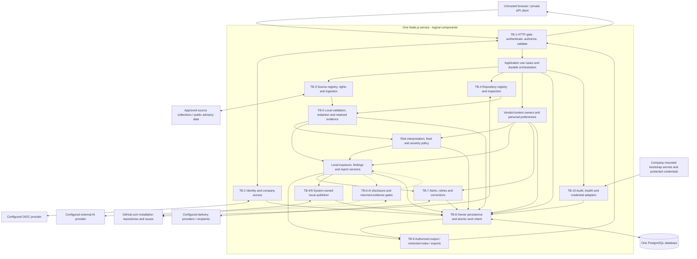

# Architecture

This file owns components, interfaces, data ownership and flow, trust boundaries, and technology choices. Product behavior is defined in [REQUIREMENTS.md](REQUIREMENTS.md), presentation in [DESIGN.md](DESIGN.md), controls in [SECURITY.md](SECURITY.md), events in [SECURITY_EVENTS.md](SECURITY_EVENTS.md), and agent workflow in [AGENTS.md](AGENTS.md). References to relocated requirement IDs resolve through REQUIREMENTS.md's owner links.

This is a specification, not an implemented application. Architecture choices below were accepted in the 2026-11-04 decision pass. Package installation remains subject to the recorded verification gates; selection is not implementation evidence.

## Stack

The confirmed core is Node.js/Fastify for all server-side surfaces, one deployable application service and one PostgreSQL database, deployed using Docker on the company-operated server required by NFR-4.1. Linux containers provide the portable runtime; hardware is company-supplied and measured under NFR-4.2.

**Client and API:** browser-only React 19 with React DOM covers the required forms, filters, note preview, themes and status updates. Resource-oriented HTTP/JSON and authenticated file exports fit FR-6.4–FR-6.5 without another protocol. Web and private API entry points share Fastify routing, schemas, authentication hooks and error translation. Browser compatibility is specified in NFR-4.4.

The pin review is recorded in [docs/DEPENDENCY_REVIEW.md](docs/DEPENDENCY_REVIEW.md), dated 2026-11-04. These are architectural selections, not installed dependencies or integration/load-test results. Provider credentials, model IDs, source schemas and host hardware are installation inputs.

| Technology | Exact version | Classification | Requirement and reason |
| --- | --- | --- | --- |
| Node.js, including native HTTP, fetch, crypto, streams, timers and worker threads | **26.13.0** ([release](https://nodejs.org/en/blog/release/v26.13.0)) | **Baseline core** runtime; version selected | One common runtime for the API, ingestion, analysis, exports and delivery; the current LTS release provides the common supported runtime; its recent LTS transition changes metadata, with Linux libatomic compatibility covered by container validation. |
| PostgreSQL, including relational tables, JSONB, transactions and durable work records | **18.6** ([release](https://www.postgresql.org/docs/release/18.6/)) | **Baseline core** store; version selected | FR-8.16 and NFR-1.3 require atomic evidence/work-intent persistence; PostgreSQL supplies relational transactions and JSONB in one store. |
| `fastify` | **5.12.8** ([metadata](https://registry.npmjs.org/fastify/5.12.8)) | **Baseline core**, confirmed framework; version selected | Native HTTP has no request-schema/routing lifecycle; Fastify supplies these together without a separate validation framework. |
| `pg` | **8.23.1** ([metadata](https://registry.npmjs.org/pg/8.23.1)) | **Selected** add-on for **FR-8.16; NFR-1.3** | Node.js and Fastify do not implement the PostgreSQL wire protocol or transaction client; direct SQL keeps a second persistence abstraction unnecessary. |
| `openid-client` | **6.8.9** ([metadata](https://registry.npmjs.org/openid-client/6.8.9)) | **Selected** add-on for **FR-7.1, FR-7.6–FR-7.9** | Node crypto and HTTP are not an OIDC relying-party implementation; this package handles provider protocol operations behind the identity adapter. |
| `jose` | **6.2.15** ([metadata](https://registry.npmjs.org/jose/6.2.15)) | **Selected** add-on for **FR-7.6** | Generic API bearer JWT verification and issuer-key handling need a JOSE verifier; an OIDC login client alone does not implement the API's resource-server policy. Token handling follows [SEC-2](SECURITY.md#sec-2--identity-sessions-and-authorization). |
| `fast-xml-parser` | **5.12.0** ([metadata](https://registry.npmjs.org/fast-xml-parser/5.12.0)) | **Selected** add-on for **FR-8.4** | Node.js has JSON parsing but no XML parser for RSS/Atom; source adapters still own feed semantics and validation. |
| `parse5` | **8.1.0** ([metadata](https://registry.npmjs.org/parse5/8.1.0)) | **Selected** add-on for **FR-8.4, FR-9.4** | Node.js has no HTML parser for permitted article-text extraction; parsing controls are in [SEC-5](SECURITY.md#sec-5--repository-inspection-and-resource-budgets). |
| `markdown-it` | **15.0.3** ([metadata](https://registry.npmjs.org/markdown-it/15.0.3)) | **Selected** add-on for **FR-9.5** | Platform string operations do not parse Markdown structure; parsed tokens feed the shared note representation under [SEC-7](SECURITY.md#sec-7--rendering-exports-and-external-disclosure). |
| `pdfkit` | **0.20.2** ([metadata](https://registry.npmjs.org/pdfkit/0.20.2)) | **Selected** add-on for **FR-4.7, FR-4.12; NFR-3.1** | Node.js has no PDF writer/font embedder; explicit drawing supports grayscale hatching and independent print layout without a browser service. Pagination remains application responsibility. |
| `semver` | **7.8.6** ([metadata](https://registry.npmjs.org/semver/7.8.6)) | **Selected** add-on for **FR-2.7, FR-3.14** | Node.js has no npm range comparator; this covers npm semantics only and must not stand in for other ecosystems' rules. |
| `@renovatebot/pep440` | **6.0.0** ([upstream](https://github.com/renovatebot/pep440), [registry](https://registry.npmjs.org/@renovatebot%2fpep440/6.0.0)) | **Selected** add-on for **FR-2.7, FR-3.14** | PyPI ordering/ranges are not npm SemVer; the specialized comparator has no runtime transitives and avoids duplicating complex version rules. |
| `yaml` | **2.9.1** ([upstream](https://github.com/eemeli/yaml), [registry](https://registry.npmjs.org/yaml/2.9.1)) | **Selected** add-on for **FR-3.12–FR-3.14** | Native JSON and XML parsers cannot read YAML lockfiles, GitHub Actions and configuration; use one established parser with bounded untrusted-input handling. |
| `smol-toml` | **1.9.1** ([upstream](https://github.com/squirrelchat/smol-toml), [registry](https://registry.npmjs.org/smol-toml/1.9.1)) | **Selected** add-on for **FR-3.12–FR-3.14** | TOML manifests/locks need a compliant parser; Node.js has none and this parser has no runtime transitives. |
| `nodemailer` | **10.3.1** ([upstream](https://github.com/nodemailer/nodemailer), [registry](https://registry.npmjs.org/nodemailer/10.3.1)) | **Selected** add-on for **FR-10.11** | Node HTTP cannot send SMTP/MIME messages; the established mail library avoids hand-written protocol handling and has no runtime transitives. |
| `react`, `react-dom` | **19.3.1** each; registry and upstream release checked 2026-11-04; installation gate AR-001 | Selected browser UI | FR-6.1, FR-6.8–FR-6.10: user-selected component model for interactive forms, themes and live status; accepts the maintenance cost over native DOM modules. No React server renderer, Server Components, Server Functions, Next.js, router or state-management package is selected. |
| Atkinson Hyperlegible Next | **7925f50f649b3813257faf2f4c0b381011f434f1** ([source revision](https://github.com/googlefonts/atkinson-hyperlegible-next/tree/7925f50f649b3813257faf2f4c0b381011f434f1)) | **Add-on — NFR-3.1**, required asset; pin selected | System typeface selected in [NFR-3.1](DESIGN.md#typography); upstream WOFF2/web and static TTF/PDF assets fit the two renderers. |
| Source Serif 4 | **4.005R** ([release](https://github.com/adobe-fonts/source-serif/releases/tag/4.005R)) | **Add-on — NFR-3.1**, required asset; pin selected | Publisher-text face selected in [NFR-3.1](DESIGN.md#typography); static TTF/PDF and WOFF2/web avoid the documented CFF2 Windows issue. |
| IBM Plex Mono | **2f9ba1b25957d958db71a849e85d72e3ecfb845a** ([Mono source revision](https://github.com/IBM/plex/tree/2f9ba1b25957d958db71a849e85d72e3ecfb845a/packages/plex-mono)) | **Add-on — NFR-3.1**, required asset; pin selected | Identifier/code face selected in [NFR-3.1](DESIGN.md#typography); static TTF and complete WOFF2 assets require no font npm package. |
| OIDC providers: Google, Okta, Microsoft Entra, PingOne | OIDC **1.0** discovery contract; one admin-configured issuer/client at a time | **Add-on — FR-7.1**, required integrations | Provider choice and claim/token contracts are company configuration; no additional provider SDK is selected; activation controls are in [SEC-2](SECURITY.md#sec-2--identity-sessions-and-authorization). |
| GitHub.com GitHub App and global advisory API | **2026-03-10** ([version contract](https://docs.github.com/en/rest/about-the-rest-api/api-versions)) | **Add-on — FR-2.5, FR-3.3–FR-3.5, FR-10.8**, required integration | Native fetch through dedicated adapters is sufficient for HTTP; endpoint/permission compatibility is an integration acceptance gate. Public advisory ingestion and private installation access remain separate. |
| RSS/Atom, documented JSON APIs and permitted HTML retrieval | RSS **2.0**, Atom **1.0**; JSON/HTML mappings versioned with each source configuration | **Add-on — FR-8.4**, required formats; dialect choices selected | Existing XML/HTML parsers plus native JSON parsing support declarative source registration; source adapters own dialect and mapping interpretation (FR-8.3–FR-8.4). |
| SMTP | SMTP **RFC 5321** with configured authenticated TLS transport | **Add-on — FR-10.11**, required integration | Admins supply the company mail-server connection; Nodemailer handles transport, not delivery policy. |
| Twilio SMS and WhatsApp | Programmable Messaging API **2010-04-01** ([message resource](https://www.twilio.com/docs/messaging/api/message-resource)) | **Add-on — FR-10.11**, required integration | One native-HTTP adapter covers both channels; setup prerequisites follow FR-10.11; no provider SDK is needed. |
| Slack Web API | Provider's **unversioned** Web API contract, reviewed **2026-11-04** ([chat.postMessage](https://docs.slack.dev/reference/methods/chat.postMessage/)) | **Add-on — FR-10.12**, required integration | Admin-configured bot connection supports individual and shared-channel destinations through native HTTP; no Slack SDK needed. |
| OpenAI Responses API | HTTP API **v1** ([official guide](https://developers.openai.com/api/docs/guides/text)) | **Add-on — FR-12.7**, required provider option | Native HTTP supports the narrow text-generation contract; configuration and assessment metadata follow FR-12.7. |
| Anthropic Messages API | HTTP API **v1**, `anthropic-version: 2026-10-21` ([versioning](https://platform.claude.com/docs/en/api/versioning)) | **Add-on — FR-12.7**, required provider option | Native HTTP avoids an SDK; this contract excludes removed sampling parameters and records the selected model. |
| Google Gemini generateContent API | HTTP API **v1beta** ([contract](https://ai.google.dev/api/generate-content)) | **Add-on — FR-12.7**, required provider option | The documented native-HTTP generation endpoint meets the requirement without a framework; isolate its beta contract behind the adapter and validate before release. |
| Docker Engine | **29.9.3** ([release](https://docs.docker.com/engine/release-notes/29/)) | **Add-on — NFR-4.1**, required platform; validation pin selected | Company-owned Docker is confirmed; this security patch is the initial validation target. The host OS and hardware belong to company operations. |
| npm | **11.20.0**, bundled with Node.js **26.13.0** ([distribution metadata](https://nodejs.org/dist/index.json)) | **Selected** build tooling | NFR-5.5: use the runtime-bundled manager rather than independently upgrading to npm 12; dependency workflow is in [AGENTS.md](AGENTS.md#third-party-libraries), and lockfile enforcement in [SEC-9](SECURITY.md#sec-9--build-and-deployment). |

### Service and persistence organization

One modular service contains HTTP handlers, orchestration, durable-job consumers, domain policies and integration adapters. CPU-heavy parsing and PDF work use native worker threads within that service; resource enforcement is in [SEC-5](SECURITY.md#sec-5--repository-inspection-and-resource-budgets). No current requirement forces independently deployed workers.

Relational identifiers, relationships and uniqueness constraints represent ownership, revisions and idempotency; JSONB holds source-specific structured facts with provenance. PostgreSQL also holds server-side sessions, checkpoints, job leases, retry deadlines, delivery intent and audit history. Atomic owner/work commits avoid a message broker, Redis, search service, object store or separate scheduler. Fastify's baseline logger supplies structured telemetry; audit and telemetry use the shared event projection defined in [SECURITY_EVENTS.md](SECURITY_EVENTS.md#event-contract).

The secret adapter connects company-mounted bootstrap secrets and encrypted connector credentials to their consumers; storage, key handling and restore controls are in [SEC-6](SECURITY.md#sec-6--secrets-retention-and-external-ai). Backup ownership and product instructions are in NFR-4.3.

## Components and Flows

Logical components below share the application service. **SUPPORTED** means requirements and architectural boundaries are specified; **PARTIALLY DEFINED** means implementation/acceptance details remain. Neither status claims implementation or test coverage.

| Component | Responsibility | Data owned | Requirement IDs | Status |
| --- | --- | --- | --- | --- |
| Web presentation and private HTTP API | Present workflows; translate validated input and domain outcomes | No authoritative business data; temporary view state only | FR-6.1–FR-6.10; FR-7.9; NFR-4.4; DESIGN.md | SUPPORTED |
| Identity and company access | OIDC login, sessions, account identity, role refresh and company policy | Single-company identity/display name, one active issuer/client/mapping configuration, accounts, sessions and authorization freshness | FR-6.9; FR-7.1–FR-7.9 | PARTIALLY DEFINED |
| Source registry and ingestion | Admin source approval, hourly retrieval, validation, revisions and checkpoints | Registrations, permission versions, original permitted text/payloads, immutable revisions, retrieval checkpoints and run outcomes | FR-1.2–FR-1.3; FR-2.2–FR-2.6; FR-8.1–FR-8.7; FR-8.11–FR-8.24 | PARTIALLY DEFINED |
| Risk interpretation and feed policy | Extract evidence-backed facts, link canonical risks, select feed items | Extracted claims/evidence locations, canonical risks, source assessments, normalized severity provenance, relevance reasons and incident revisions | FR-1.1–FR-1.6; FR-2.1, FR-2.6–FR-2.7; FR-4.10–FR-4.11; FR-5.3–FR-5.4; FR-8.22 | PARTIALLY DEFINED |
| Repository registry and local inspection | Validate installations; select branches; inspect accessible immutable trees | Registrations, access status, branch selection, immutable commits, dependency/analysis snapshots and redacted evidence | FR-3.1–FR-3.8; FR-3.11–FR-3.22; FR-8.9–FR-8.10 | PARTIALLY DEFINED |
| Vendor catalog and company context | Resolve vendors/aliases/ownership; manage deployment context and notes | Canonical vendors, aliases, dated relationships, products, deployments, owners, company notes and revisions | FR-4.8; FR-5.5–FR-5.8; FR-9.5 | SUPPORTED |
| Personal preferences | Maintain user-owned subscriptions and communication/theme settings | User watchlists, non-Slack personal channel/destination preferences, fallback order, routing rules and theme | FR-5.1–FR-5.2, FR-5.7, FR-5.9; FR-6.8; FR-7.5; FR-10.2 | SUPPORTED |
| Local exposure and reports | Match local evidence; assess protections, impact/confidence; version findings and reports | Findings, assessment outcomes, rationale, evidence links, report versions and correction reasons | FR-2.7; FR-3.6, FR-3.9, FR-3.13–FR-3.15; FR-4.1–FR-4.11; FR-12.4–FR-12.5 | PARTIALLY DEFINED |
| Configurable AI adapters and local disclosure gate | Prepare reduced input; validate output; associate advisory suggestions with local evidence | Provider/model configuration and credential references, local placeholder mappings and analysis/model metadata; no persistent raw secret values | FR-12.1–FR-12.7; FR-11.5 | PARTIALLY DEFINED |
| Presentation/export projection | Create authorized web/API/report representations and PDF/CSV/JSON | No new business truth; references a report version and records export time through audit | FR-3.4; FR-4.7, FR-4.12; FR-9.1–FR-9.5; SECURITY NFR-2.4; DESIGN NFR-3.1; AGENTS NFR-3.2 | PARTIALLY DEFINED |
| Alerts and delivery | In-app alerts, configured channels, fallbacks and corrections | Connector configuration references, admin Slack destinations/routes, alerts, original-recipient/destination history, send intents, attempts, provider IDs and final status | FR-5.2, FR-5.9–FR-5.10; FR-10.1–FR-10.7, FR-10.9, FR-10.11–FR-10.12 | PARTIALLY DEFINED |
| GitHub issue publisher | Publish/update only system-owned issue content | Issue associations, publication versions, external IDs and write outcomes | FR-3.8, FR-3.17, FR-3.20; FR-10.8–FR-10.10 | PARTIALLY DEFINED |
| Durable work and orchestration | Atomically record work intent; dispatch due work; recover leases and retries | Job identities, event envelopes, status, leases, progress, retry deadlines and recovery records | FR-3.2, FR-3.19–FR-3.22; FR-6.7, FR-6.10; FR-8.16, FR-8.20–FR-8.21; NFR-1.1–NFR-1.4 | SUPPORTED |
| Audit and operational health | Record required actions and safe health projections | Append-only audit history; health projections reference owner records rather than replacing them | NFR-2.1–NFR-2.4; FR-8.17–FR-8.19; FR-10.7; FR-11.1 | SUPPORTED |

### Operation-authority contract

Every web, API, export, and worker entry point passes one code-owned operation context to the owning use case: current principal or recorded service grant, company, function, target object(s), allowed input/output properties, resource/configuration revision, and original operation identity. The use case—not the handler, job payload, result identifier, provider response, or database row—owns the authorization and transition decision. Alternate UI/API/bulk paths use the same policy record, and delayed work revalidates it at each effect and commit. The concrete route/property matrix remains implementation evidence required by `G-002`/`G-003`; this allocation closes the architectural ownership ambiguity without claiming enforcement. ([T-001](THREAT_MODEL.md#t-001), [T-003](THREAT_MODEL.md#t-003), [T-009](THREAT_MODEL.md#t-009), [T-015](THREAT_MODEL.md#t-015))

### Main data flows

1. **Identity and requests:** deployment configuration → identity adapter → account/session owner → HTTP gate → operation-authority context → owning use case → authorized output projection. Session or token recognition never substitutes for the function/object/property decision, and role/session/configuration transitions invalidate later operations and private view state. The first admitted-account transaction seeds default follows, providing idempotent restart/login behavior (FR-5.1). Provider role-refresh contracts are validated at activation under [SEC-2](SECURITY.md#sec-2--identity-sessions-and-authorization). ([T-001](THREAT_MODEL.md#t-001), [T-002](THREAT_MODEL.md#t-002), [T-003](THREAT_MODEL.md#t-003))
2. **Source intake:** scheduler → registry → retrieval adapter → parser/validator → source-revision owner. Declarative field mappings, collection filters and pagination/checkpoint configuration support new registrations in existing formats. Product approval and ingestion outcomes are in FR-8; configuration execution controls are in [SEC-1](SECURITY.md#sec-1--trust-boundaries-and-policy-ownership).
3. **Risk and work:** source-revision transaction → persisted interpretation intent → local interpretation → risk event → repository-check fan-out. The initial intent bridges a crash between acceptance and interpretation; post-commit wake-ups carry no authoritative work state. Acceptance and trigger rules are in FR-8.13–FR-8.16 and FR-3.2/FR-3.10/FR-3.18.
4. **Assessment:** check orchestrator → GitHub installation adapter → branch/commit/tree/blob readers → redacted snapshot owner → local ecosystem comparators and protection policy → finding/report owner. The risk side joins stored advisory criteria to those snapshots; optional AI is reached through the local disclosure gate. Coverage and matching behavior are in FR-2.7 and FR-3/FR-4; controls are in [SEC-5](SECURITY.md#sec-5--repository-inspection-and-resource-budgets) and [SEC-6](SECURITY.md#sec-6--secrets-retention-and-external-ai).
5. **Reports and views:** assessment transaction → finding/report revision plus output intent → web/API/export projections. Export creation records an opaque job/result reference bound to company and report revision; the worker reauthorizes before generation, and the status/download use case reauthorizes before returning metadata or bytes. Archive/source-use invalidation makes the result unavailable and temporary output is removed under SEC-5/SEC-7.  authenticated HTTP status polling provides FR-6.10 updates without a streaming protocol. PDF uses a dedicated vector renderer; all note renderers consume one application-owned representation. Presentation is in [DESIGN.md](DESIGN.md); output controls are in [SEC-7](SECURITY.md#sec-7--rendering-exports-and-external-disclosure). ([T-004](THREAT_MODEL.md#t-004))
6. **Delivery:** finding/incident/correction intent → routing policy → connector or issue adapter → closed typed adapter result → attempt/result owner. The adapter result records provider facts only; the owner alone maps documented facts to allowed delivery transitions, and unknown outcome reconciliation retains the original logical effect identity. Original recipient/destination records join correction events back to delivery history. Product routing, retry and correction semantics are in FR-10; disclosure controls are in [SEC-7](SECURITY.md#sec-7--rendering-exports-and-external-disclosure). ([T-008](THREAT_MODEL.md#t-008), [T-010](THREAT_MODEL.md#t-010))
7. **Lifecycle:** owner archive/restore operations → owner-provided active/history projections → output or work use cases. Audit and health consume owner outcomes. FR-11 defines archive behavior; installation restore invalidates prior session authority and holds durable effects/connectors behind the quarantine gate in [SEC-6](SECURITY.md#sec-6--secrets-retention-and-external-ai) until the owning policies revalidate them. ([T-017](THREAT_MODEL.md#t-017))

### Queue contract

Repository checks MUST use a durable queue; persistence and restart behavior follow [FR-3.21](REQUIREMENTS.md#repository-registration-and-exposure-checks) and [NFR-1.3](REQUIREMENTS.md#source-access-and-reliability). The queue mechanism below is selected.

 PostgreSQL work rows have unique logical keys, atomic claims and renewable leases. Logical check identity is company + originating risk event/revision + repository; attempts reference the same logical check. Findings, reports and send intents have owner-specific uniqueness keys. The event batch owns a fixed membership with stable per-repository entries (FR-3.22).

A post-commit wake-up asks consumers to drain due work; database notification is only a hint. Startup reconciliation and **30-second recovery wake-ups** re-read due persisted work, bounding detection of a lost wake-up. Expired leases return the same job/event to recovery. HTTP and lightweight ingestion/delivery handling have admission paths separate from repository slots. Scheduling behavior is in FR-3.23; fencing and transaction controls are in [SEC-8](SECURITY.md#sec-8--durable-jobs-errors-and-audit).

### Local inspection and integration contracts

**GitHub inspection:** paginated branch, commit, tree and blob APIs expose immutable content without a local checkout. Preserve API truncation indicators and recurse through accessible tree segments. Read endpoint coverage includes metadata, contents, security advisories, Dependabot alerts and security settings. Public global-advisory ingestion uses a separate adapter from installation repository access; collection coverage is defined in [FR-2.5](REQUIREMENTS.md#risk-information). Permission controls are in [SEC-5](SECURITY.md#sec-5--repository-inspection-and-resource-budgets); source configuration follows the [catalog](docs/DATA_SOURCES.md).

**parsing boundary:** native JSON, selected XML/YAML/TOML parsers and narrow local readers for line-oriented lockfiles produce syntax records. Versioned ecosystem policy modules separately interpret identity, qualifiers, ordering, revisions, dependency paths and advisory ranges. The [ecosystem contract](REQUIREMENTS.md#ecosystem-matching-contract) defines the required semantics; comparator conformance and execution controls are in [SEC-5](SECURITY.md#sec-5--repository-inspection-and-resource-budgets).

**AI interface:** provider configuration supplies the adapter and model; the local disclosure gate supplies the factual projection and local evidence handles; returned structured recommendations are resolved against the assessment's local evidence set. Provider options and metadata are in FR-12.7, and all egress/return-path controls are in [SEC-6](SECURITY.md#sec-6--secrets-retention-and-external-ai).

**connectors:** SMTP returns mail-server acceptance; a Message-ID is a correlation value, not an idempotency guarantee. Twilio returns a message SID and supports known-ID reconciliation through its API. Slack uses explicit user/channel IDs, opens direct messages where needed and posts/updates messages through native HTTP; stored channel/message identifiers support corrections. Each adapter exposes a closed typed result containing only documented provider facts; it cannot select the owning use case's authorization, finding, configuration, or delivery transition. FR-10.6 defines uncertain outcomes, and FR-10.13 defines inbound-callback scope. ([T-008](THREAT_MODEL.md#t-008), [T-010](THREAT_MODEL.md#t-010))

### Trust boundaries and enforcement points

These are logical crossings within the one-service topology. For the composed model, web owns TB-1, TB-2 and TB-9; API contributes operation/bearer/projection behavior there and owns TB-3 through TB-8 and TB-10. This is architecture ownership, not separate deployments or duplicate controls. The table locates gates; the linked security sections define their controls. ([T-001](THREAT_MODEL.md#t-001), [T-003](THREAT_MODEL.md#t-003), [T-004](THREAT_MODEL.md#t-004), [T-008](THREAT_MODEL.md#t-008))

| Boundary | Composition owner / contributors | Crossing | Enforcement components | Controls |
| --- | --- | --- | --- | --- |
| **TB-1: client → service** | Web / API | Browser/private API requests and company responses | HTTP authentication, authorization, schema and output gates | [SEC-1–SEC-3](SECURITY.md#sec-1--trust-boundaries-and-policy-ownership), [SEC-7](SECURITY.md#sec-7--rendering-exports-and-external-disclosure) |
| **TB-2: service ↔ identity provider** | Web / API | Redirects, codes, claims, tokens and refreshed authority | Identity adapter, claim mapping and authorization policy | [SEC-2](SECURITY.md#sec-2--identity-sessions-and-authorization), [SEC-4](SECURITY.md#sec-4--outbound-requests-and-ssrf) |
| **TB-3: service ↔ external sources** | API | Collection requests and untrusted payloads | Source-use policy, egress transport, format/schema/extraction validators | [SEC-4–SEC-5](SECURITY.md#sec-4--outbound-requests-and-ssrf) |
| **TB-4: service ↔ GitHub.com** | API | Installation reads/issue writes and separate public-advisory reads | Installation/repository policy, registration/inspection and issue-output gates | [SEC-4–SEC-5](SECURITY.md#sec-4--outbound-requests-and-ssrf), [SEC-7](SECURITY.md#sec-7--rendering-exports-and-external-disclosure) |
| **TB-5: transient raw input → retained/local analysis data** | API | Text/parser output becomes durable evidence or model input | Orchestrator context, input owner, local classifier/redactor and evidence validators | [SEC-1](SECURITY.md#sec-1--trust-boundaries-and-policy-ownership), [SEC-5–SEC-6](SECURITY.md#sec-5--repository-inspection-and-resource-budgets) |
| **TB-6: service → optional external AI → service** | API | Reduced input leaves; advisory output returns | AI credential adapter, source-use/disclosure and returned-evidence gates | [SEC-6](SECURITY.md#sec-6--secrets-retention-and-external-ai) |
| **TB-7: service ↔ notification providers/recipients** | API | Messages and provider results | Connector credential adapter, delivery policy and output/result validators | [SEC-4](SECURITY.md#sec-4--outbound-requests-and-ssrf), [SEC-7–SEC-8](SECURITY.md#sec-7--rendering-exports-and-external-disclosure) |
| **TB-8: service ↔ PostgreSQL** | API | Owner reads/writes and transactional work | Persistence identity, scoped owner interfaces, constraints and transactions | [SEC-3](SECURITY.md#sec-3--http-validation-and-database-access), [SEC-8](SECURITY.md#sec-8--durable-jobs-errors-and-audit) |
| **TB-9: authorized data → rendered/downloaded/published output** | Web / API | UI/API, exports, notes, quotations, issues and messages | Caller/service context and output projection/rendering gates | [SEC-7](SECURITY.md#sec-7--rendering-exports-and-external-disclosure) |
| **TB-10: service ↔ restricted configuration, secrets and operational output** | API | Bootstrap/credentials enter; audit/health records leave | Bootstrap/secret adapter, admin use cases, configuration validators and safe event projection | [SEC-6](SECURITY.md#sec-6--secrets-retention-and-external-ai), [SEC-8–SEC-11](SECURITY.md#sec-8--durable-jobs-errors-and-audit) |

## Dependency Rules

- **DR-1 — One directional structure.** The dependency direction is entry points → application use cases → domain policies and owner contracts. Persistence/vendor/presentation adapters implement those contracts and depend inward; a composition boundary connects implementations. Domain rules never import HTTP handlers, UI rendering, SQL clients, provider SDKs or model clients.
- **DR-2 — Explicit ownership.** Only the component in the component table may mutate its owned records. Other components request owner operations or immutable owner-provided projections carrying company and provenance identifiers; shared storage does not relax ownership.
- **DR-3 — Acyclic business dependencies.** The read direction is outputs/delivery → findings → risk facts, repository snapshots and vendor/context projections; risk interpretation → source revisions and vendor projections; subscriptions → vendor identity; protected use cases → access policy. Ingestion, inspection and vendor ownership do not depend on findings/delivery. Orchestrators coordinate owners without reverse imports.
- **DR-4 — Events do not reverse dependencies.** Producers record stable, versioned event facts without importing consumers. Durable orchestration routes ingestion intent → interpretation → assessment → reporting/delivery; corrections follow that direction. Trigger/failure-loop behavior is in FR-3.18 and FR-10.6.
- **DR-5 — Transactions own consistency, not external calls.** The use-case transaction boundary joins owner changes and work intent in PostgreSQL; adapters perform external requests between persisted transitions. Transaction, fencing and side-effect controls are in [SEC-3](SECURITY.md#sec-3--http-validation-and-database-access) and [SEC-8](SECURITY.md#sec-8--durable-jobs-errors-and-audit).
- **DR-6 — Versions remain attributable.** Source owners expose revisions and collection-time rights; repository owners expose commit snapshots; report owners reference those exact versions. Evidence behavior is in FR-4.5–FR-4.6/FR-4.9 and FR-8.5–FR-8.9/FR-8.13–FR-8.15; retained-secret controls are in [SEC-6](SECURITY.md#sec-6--secrets-retention-and-external-ai).
- **DR-7 — Policy stays local.** Ecosystem interpretation, severity, confidence, incidents, permissions, retries and routing belong to domain policies. Vendor adapters translate protocols and return typed facts/errors. Model authority controls are in [SEC-6](SECURITY.md#sec-6--secrets-retention-and-external-ai).
- **DR-8 — Presentation is a projection.** Web, API, exports, alerts and issues consume shared finding/attribution/normalization projections. One restricted note representation serves all renderers and preview; presentation is in [DESIGN.md](DESIGN.md), controls in [SEC-7](SECURITY.md#sec-7--rendering-exports-and-external-disclosure).
- **DR-9 — Service authority is explicit.** HTTP owner interfaces carry user/company context; job interfaces carry original event and service context. Context validation and current-authorization controls are in [SEC-1](SECURITY.md#sec-1--trust-boundaries-and-policy-ownership) and [SEC-8](SECURITY.md#sec-8--durable-jobs-errors-and-audit).
- **DR-10 — Integrations terminate at adapters.** Source/GitHub/identity/notification/AI adapters are the external protocol boundary. Egress and execution controls are in [SEC-4–SEC-6](SECURITY.md#sec-4--outbound-requests-and-ssrf).
- **DR-11 — Lifecycle rules are shared.** Owner policies feed active/archive projections and restoration workflows across surfaces. Audit and health observe owner outcomes without owning business state. Behavior is in FR-11; enforcement is in [SEC-7–SEC-8](SECURITY.md#sec-7--rendering-exports-and-external-disclosure).
- **DR-12 — Add technology only against a requirement.** Additional services/stores require a requirement the one-service/one-database design cannot meet. Package proposals and override evidence follow [AGENTS.md](AGENTS.md#third-party-libraries); build enforcement follows [SEC-9](SECURITY.md#sec-9--build-and-deployment).

## Component diagram

Arrows show runtime data movement, not imports (DR-1–DR-4). Service boxes are logical groups; dashed AI links are conditional. The store-to-output edge carries authorized report revisions plus export job/result state; it does not make stored identifiers authorization evidence. ([T-004](THREAT_MODEL.md#t-004))

## Decision handoff

Choices adopted 2026-11-04: Linux containers; browser React with Fastify HTTP/JSON; one modular service and bounded worker threads; PostgreSQL owner records, JSONB, sessions and durable work; stable queue ordering and 30-second recovery; immutable GitHub API inspection; syntax parsing separated from ecosystem semantics; declarative source mappings; first-admission default follows; authenticated status polling; typed provider results; and DR-1/DR-3 dependency direction. These choices minimize independently operated services and preserve existing authorization owners. Poll only while the relevant view is active, cancel requests on unmount/signout, and reject responses belonging to an obsolete authorization/view generation. Polling never extends session idle life.

- **AR-001 — DEFERRED: dependency installation evidence.** Owner: project lead/release maintainer. React/React DOM 19.3.1 are the chosen targets, not verified installed dependencies. Before adding them, complete NFR-5 publisher/ownership, contents, resolved-tree, license, support, migration and advisory checks and record results in docs/DEPENDENCY_REVIEW.md. Existing reviewed pins are accepted selections, with the same actual-lockfile revalidation gate. This blocks package addition and release, not specification work.
- **AR-002 — DEFERRED: frontend build and checking tool pins.** Owner: release maintainer. Use a bundled production client served by Fastify, with checked JSDoc for server JavaScript and checked client contracts. Select the smallest maintained bundler/checker that meets React compilation and SEC-9 requirements after NFR-5 verification. Do not silently add a framework, transpiler, linter or TypeScript dependency. Blocks the implementation toolchain only; AGENTS.md tracks the commands.
- **AR-003 — DEFERRED: installation inputs.** Owner: deploying company IT; project lead tracks completion. Supply hardware, HTTPS origin/ingress, OIDC issuer/client/role-refresh contract, GitHub installation grants, connector credentials/destinations, optional AI model/account/data-handling approval and backup/recovery objectives at installation. Validate each before enabling its dependent feature; disabled optional connectors do not block local analysis. Exact release browser builds and capacity measurements are acceptance evidence, not guessed configuration.

The export projection owner owns job/result metadata and protected temporary output; the durable-work owner owns leases/recovery. Exports are regenerated from retained report revisions, are not durable static assets, and are removed on invalidation, successful transfer or 15 minutes after generation, whichever comes first. Status/download always use the current authorization gate.
